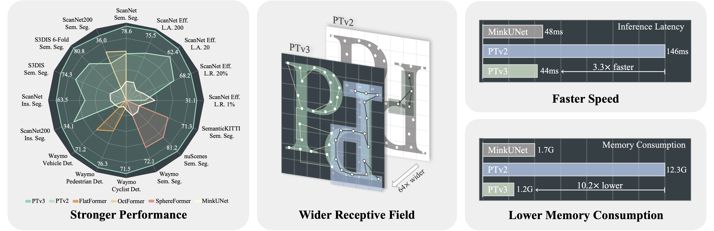

<p align="center">
    <!-- pypi-strip -->
    <picture>
    <source media="(prefers-color-scheme: dark)" srcset="https://raw.githubusercontent.com/Pointcept/PointTransformerV3/main/assets/teaser.png">
    <source media="(prefers-color-scheme: light)" srcset="https://raw.githubusercontent.com/Pointcept/PointTransformerV3/main/assets/teaser.png">
    <!-- /pypi-strip -->
    
    <!-- pypi-strip -->
    </picture><br>
    <!-- /pypi-strip -->
</p>

This repo is the official project repository of the paper **Point Transformer V3: Simpler, Faster, Stronger**.  
IEEE Conference on Computer Vision and Pattern Recognition (**CVPR**) 2024 - Oral  
[ Backbone ] [PTv3] - [ [arXiv](https://arxiv.org/abs/2312.10035) ] [ [Bib](https://xywu.me/research/ptv3/bib.txt) ] [ [Weight](https://huggingface.co/Pointcept/PointTransformerV3) ]

It is also a pip package, `pointtransformerv3`: PTv3 in plain PyTorch, with Triton kernels on the GPU. Besides PTv3, it runs the released weights of the pre-training works built on PTv3:

- **Sonata: Self-Supervised Learning of Reliable Point Representations**  
IEEE Conference on Computer Vision and Pattern Recognition (**CVPR**) 2025 - Highlight  
[ Pretrain ] [Sonata] - [ [Project](https://xywu.me/sonata/) ] [ [arXiv](https://arxiv.org/abs/2503.16429) ] [ [Bib](https://xywu.me/research/sonata/bib.txt) ] [ [Weight](https://huggingface.co/facebook/sonata) ]

- **Concerto: Joint 2D-3D Self-Supervised Learning Emerges Spatial Representations**  
Conference on Neural Information Processing Systems (**NeurIPS**) 2025  
[ Pretrain ] [Concerto] - [ [Project](https://pointcept.github.io/Concerto/) ] [ [arXiv](https://arxiv.org/abs/2510.23607) ] [ [Bib](https://xywu.me/research/concerto/bib.txt) ] [ [Weight](https://huggingface.co/Pointcept/Concerto) ]

- **Utonia: Toward One Encoder for All Point Clouds**  
International Conference on Machine Learning (**ICML**) 2026  
[ Pretrain ] [Utonia] - [ [Project](https://pointcept.github.io/Utonia/) ] [ [arXiv](https://arxiv.org/abs/2603.03283) ] [ [Bib](https://pointcept.github.io/Utonia/#citation) ] [ [Weight](https://huggingface.co/Pointcept/Utonia) ]

## Highlights

- *Oct 2026*: PTv3 is now a pip package, `pointtransformerv3`, with optimizations from Pointcept2, our next codebase. It needs no spconv or FlashAttention (plain PyTorch with Triton kernels), runs 1.7-4.7x faster with 18-31% less memory on the GPU, also runs on the CPU, and loads the Sonata, Concerto and Utonia weights. See [docs/acceleration.md](https://github.com/Pointcept/PointTransformerV3/blob/main/docs/acceleration.md).
- *Apr 2024*: PTv3 is selected as one of the 90 Oral presentations of CVPR'24.
- *Feb 2024*: PTv3 is accepted by CVPR'24.
- *Dec 2023*: We released the model code of PTv3 and the experiment records for ScanNet and ScanNet200.

## Speed

This release is a technical pre-release of Pointcept2: its PTv3 optimizations, packaged on their own. The classic single-file implementation stays on the [legacy](https://github.com/Pointcept/PointTransformerV3/tree/legacy) branch.

| model | ScanNet 150k | ScanNet 298k | ScanNet++ 1.13M | peak memory |
|---|---|---|---|---|
| PTv3 | 53 → 31 ms (1.7x) | 71 → 31 ms (2.3x) | 201 → 46 ms (4.4x) | -25 to -31% |
| Sonata | 87 → 35 ms (2.5x) | 112 → 35 ms (3.2x) | 271 → 58 ms (4.7x) | -28 to -30% |
| Concerto large | 101 → 35 ms (2.9x) | 139 → 38 ms (3.7x) | 337 → 76 ms (4.4x) | -29 to -31% |
| Utonia | 108 → 44 ms (2.5x) | 153 → 42 ms (3.6x) | 419 → 118 ms (3.5x) | -18 to -19% |

Forward time of the original code → this package, median on one RTX PRO 6000 with the same grid-sampled inputs. Each side runs its default: the originals in fp32 with fp16 FlashAttention (Utonia: bf16), this package with fp16 autocast. More in [docs/benchmark.md](https://github.com/Pointcept/PointTransformerV3/blob/main/docs/benchmark.md).

## Install

```bash
pip install pointtransformerv3     # needs torch >= 2.10; install torch first for another CUDA build
uv add pointtransformerv3          # in a uv project
```

From source, with [uv](https://docs.astral.sh/uv/):

```bash
git clone https://github.com/Pointcept/PointTransformerV3 && cd PointTransformerV3
uv sync                            # Python 3.12, torch with CUDA 13 on Linux; --extra cu126 or --extra cpu
```

## Get features

```python
import pointtransformerv3 as ptv3

model = ptv3.load("sonata")                  # downloads the weights once; fp16 on CUDA
feat = model.embed(coord, color, normal)     # (N, 1232) features for the N input points
labels = ptv3.load("ptv3_scannet").predict(coord, color, normal).argmax(1)  # ScanNet-20
```

Inputs are numpy arrays or tensors: `coord` (N, 3) in meters, `color` (N, 3) in 0-255 and `normal` (N, 3). Concerto and Utonia take zeros for a missing color or normal. For outdoor LiDAR, use Utonia with `embed(..., scale=0.2, center=False)`. `embed` also takes lists of clouds and runs them as one batch; `ptv3.prepare`, `ptv3.collate` and `ptv3.upcast` are its steps if you need them separately. The demos use all three.

## Demo

The scripts in [demo/](https://github.com/Pointcept/PointTransformerV3/tree/main/demo) are the Sonata, Concerto and Utonia demos, ported to this package. They run the pre-trained encoders on indoor scans, outdoor LiDAR, an aerial scan of Hong Kong, robot manipulation scenes, single objects and point clouds lifted from video. The scripts take `--model` (default `utonia`), `--wo_color`, `--wo_normal` and `--sample` (another pointcept/demo sample or your own .npz; the video demo takes `--input`). Each writes a PLY file and a PNG snapshot to `demo/output/`; `--show` opens an open3d viewer (`uv sync --extra demo`). The point clouds are downloaded on first use from the [pointcept/demo](https://huggingface.co/datasets/pointcept/demo) dataset.

<p align="center">
    <br>
    
</p>

Top: Utonia on an indoor scan (PCA colors, similarity to a query point, ScanNet-20 segmentation), an object, a manipulation scene, a LiDAR sweep and Hong Kong from the air. Bottom: a LiDAR sweep, and Concerto's outdoor checkpoint on it with and without color. The figures come from the Utonia and Concerto repositories. Their project pages ([Utonia](https://pointcept.github.io/Utonia/), [Concerto](https://pointcept.github.io/Concerto/)) have an interactive gallery of these clouds and recordings of the video demo.

| demo | what it shows | command |
|---|---|---|
| `0_pca.py` | first principal components of the features as colors, indoor scan | `uv run demo/0_pca.py --model concerto_large` |
| `1_similarity.py` | cosine similarity of a query point to a local view and to the whole scan | `uv run demo/1_similarity.py` |
| `2_sem_seg.py` | ScanNet-20 segmentation with a linear probe (`utonia`, `concerto_large`, `sonata`) or `ptv3_scannet` | `uv run demo/2_sem_seg.py --model ptv3_scannet` |
| `3_batch.py` | two clouds in one forward (`embed` on lists, `prepare` + `collate`) | `uv run demo/3_batch.py --rotate` |
| `4_pca_hk.py` | aerial point cloud of Hong Kong, 40M points (1.5 GB download) | `uv run demo/4_pca_hk.py` |
| `5_pca_manipulation.py` | a robot manipulation scene (RGB-D, no normals) | `uv run demo/5_pca_manipulation.py` |
| `6_pca_object.py` | an object upright and on its side, in one batch | `uv run demo/6_pca_object.py` |
| `7_pca_outdoor.py` | outdoor LiDAR, Utonia or Concerto's outdoor checkpoint | `uv run demo/7_pca_outdoor.py --model concerto_large_outdoor` |
| `8_pca_video.py` | a cloud lifted from a video or a folder of images by VGGT | `uv run demo/8_pca_video.py --input video.mp4` |

The PCA, similarity and batch demos run with every encoder preset (`sonata*`, `concerto*`, `utonia*`); demos 4 to 7 run with the Utonia presets (7 also with `concerto_large_outdoor`). `--wo_color` and `--wo_normal` replace the colors or normals with zeros, which Concerto and Utonia accept. The PCA colors do not depend on the device or a seed; with the default models they look like the figures above. The video demo needs [VGGT](https://github.com/facebookresearch/vggt), which is not a dependency of this package: install it yourself, for example `uv run --with "vggt @ git+https://github.com/facebookresearch/vggt" --with "torchvision==0.27.*" demo/8_pca_video.py --input video.mp4` (a torchvision that matches your torch).

## Model zoo

| preset | params | weights | license |
|---|---|---|---|
| `ptv3_scannet` | 46.2M | [Pointcept/PointTransformerV3](https://huggingface.co/Pointcept/PointTransformerV3) | MIT |
| `sonata` | 108.5M | [facebook/sonata](https://huggingface.co/facebook/sonata) | CC BY-NC 4.0 (Meta) |
| `sonata_small` | 38.6M | [facebook/sonata](https://huggingface.co/facebook/sonata) | CC BY-NC 4.0 (Meta) |
| `concerto`, `concerto_siglip`, `concerto_origin` | 108.5M | [Pointcept/Concerto](https://huggingface.co/Pointcept/Concerto) | CC BY-NC 4.0 + permission |
| `concerto_large` | 207.7M | [Pointcept/Concerto](https://huggingface.co/Pointcept/Concerto) | CC BY-NC 4.0 + permission |
| `utonia` | 137.3M | [Pointcept/Utonia](https://huggingface.co/Pointcept/Utonia) | CC BY-NC 4.0 + permission |
| `utonia_small`, `utonia_tiny` | 37.2M, 9.3M | [Pointcept/Utonia](https://huggingface.co/Pointcept/Utonia) | CC BY-NC 4.0 + permission |
| `ptv3` | 46.2M | random init, for training | - |

`sonata`, `concerto_large` and `utonia` come with a ScanNet-20 linear probe: `ptv3.load("sonata", head="scannet20")`. `concerto_origin` is the model from the Concerto paper; `concerto` and `concerto_large` are the default checkpoints on its Hugging Face page. Weights are downloaded on first use. For agreement with the original code, see [docs/parity.md](https://github.com/Pointcept/PointTransformerV3/blob/main/docs/parity.md).

The old single-file `model.py` is on the [legacy](https://github.com/Pointcept/PointTransformerV3/tree/legacy) branch. `ptv3.PointTransformerV3` takes its arguments (except RPE and PDNorm) and loads its checkpoints. Training configs and experiment records are in [Pointcept](https://github.com/Pointcept/Pointcept).

## License

The code is released under CC BY-NC 4.0 with an additional permission for research use: see [LICENSE](https://github.com/Pointcept/PointTransformerV3/blob/main/LICENSE) and [NOTICE](https://github.com/Pointcept/PointTransformerV3/blob/main/NOTICE).  
Model weights have their own licenses, listed in [NOTICE](https://github.com/Pointcept/PointTransformerV3/blob/main/NOTICE).

## Citation

If you find _PTv3_ useful to your research, please cite our work as an acknowledgment.

```bib
@inproceedings{wu2024ptv3,
    title={Point Transformer V3: Simpler, Faster, Stronger},
    author={Wu, Xiaoyang and Jiang, Li and Wang, Peng-Shuai and Liu, Zhijian and Liu, Xihui and Qiao, Yu and Ouyang, Wanli and He, Tong and Zhao, Hengshuang},
    booktitle={CVPR},
    year={2024}
}

@inproceedings{wu2025sonata,
    title={Sonata: Self-Supervised Learning of Reliable Point Representations},
    author={Wu, Xiaoyang and DeTone, Daniel and Frost, Duncan and Shen, Tianwei and Xie, Chris and Yang, Nan and Engel, Jakob and Newcombe, Richard and Zhao, Hengshuang and Straub, Julian},
    booktitle={CVPR},
    year={2025}
}

@inproceedings{zhang2025concerto,
    title={Concerto: Joint 2D-3D Self-Supervised Learning Emerges Spatial Representations},
    author={Zhang, Yujia and Wu, Xiaoyang and Lao, Yixing and Wang, Chengyao and Tian, Zhuotao and Wang, Naiyan and Zhao, Hengshuang},
    booktitle={NeurIPS},
    year={2025}
}

@inproceedings{zhang2026utonia,
    title={Utonia: Toward One Encoder for All Point Clouds},
    author={Zhang, Yujia and Wu, Xiaoyang and Yang, Yunhan and Fan, Xianzhe and Li, Han and Zhang, Yuechen and Huang, Zehao and Wang, Naiyan and Zhao, Hengshuang},
    booktitle={ICML},
    year={2026}
}

@inproceedings{wu2024ppt,
    title={Towards Large-scale 3D Representation Learning with Multi-dataset Point Prompt Training},
    author={Wu, Xiaoyang and Tian, Zhuotao and Wen, Xin and Peng, Bohao and Liu, Xihui and Yu, Kaicheng and Zhao, Hengshuang},
    booktitle={CVPR},
    year={2024}
}

@inproceedings{wu2022ptv2,
    title={Point transformer V2: Grouped Vector Attention and Partition-based Pooling},
    author={Wu, Xiaoyang and Lao, Yixing and Jiang, Li and Liu, Xihui and Zhao, Hengshuang},
    booktitle={NeurIPS},
    year={2022}
}

@misc{pointcept2023,
    title={Pointcept: A Codebase for Point Cloud Perception Research},
    author={Pointcept Contributors},
    howpublished={\url{https://github.com/Pointcept/Pointcept}},
    year={2023}
}
```
